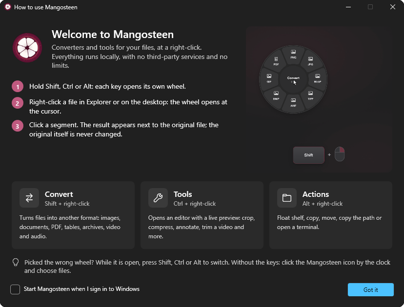
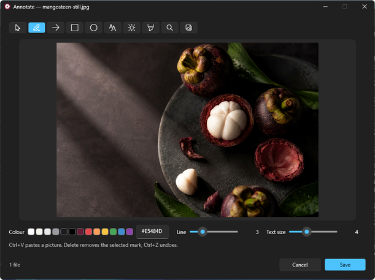
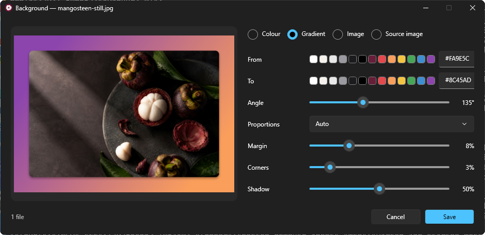
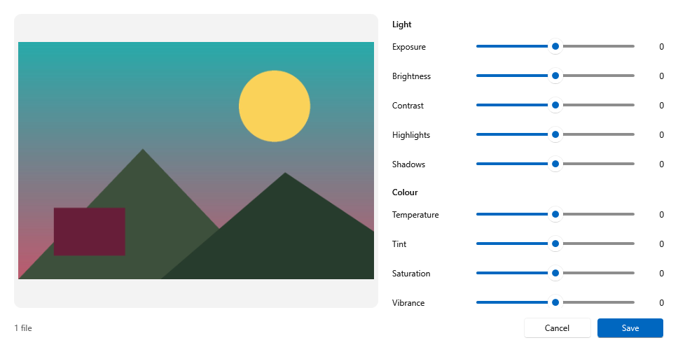
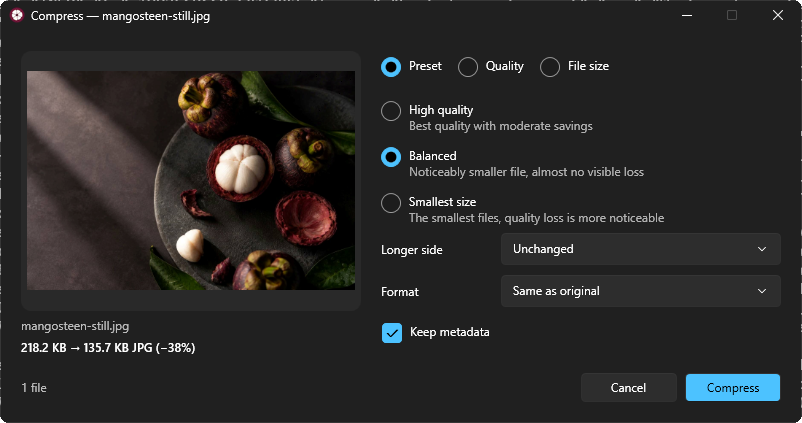
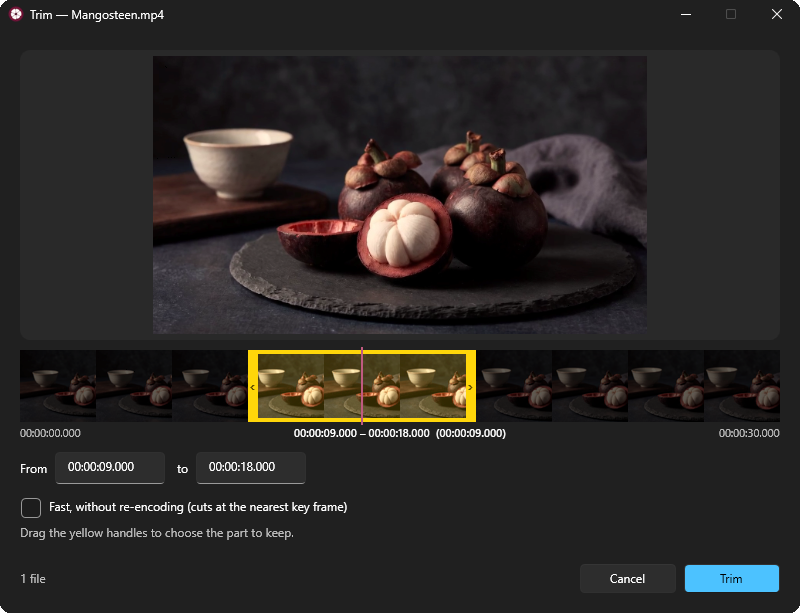
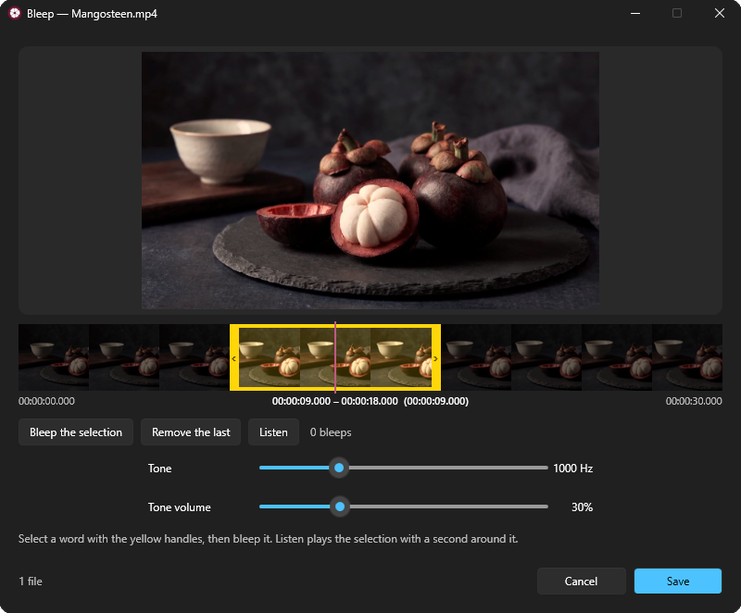

*English* · [Русский](README.ru.md)

<p align="center">
  
</p>

<h1 align="center">Mangosteen for Windows</h1>

<p align="center">
  <b>Zero-click file converter and toolbox for Windows.</b><br>
  Hold Shift, Ctrl or Alt, right-click a file, pick a segment — done.
</p>

<p align="center">
  
  
  
  
  <a href="LICENSE"></a>
</p>

<p align="center">
  <a href="https://github.com/SpaceCadet0/Mangosteen-Windows/releases/latest"><b>Download the latest version</b></a>
</p>

```
0.0 % CPU at rest · ≈13 MB private memory · 163 MB download, one exe · no admin rights, nothing asked at launch
```

<sub>Measured by CI on a GitHub windows-latest runner (Windows Server 2025, 4 cores): the published exe idle for 60 s
after start. Memory is the private working set that Task Manager shows (73 MB working set in all). The exe is 298 MB
unpacked, as it carries .NET and FFmpeg; FFmpeg runs as a separate process only while a video or audio job does.</sub>

---

The Windows sibling of [Mangosteen](https://github.com/SpaceCadet0/Mangosteen) for macOS. It lives in the notification
area and waits for a right-click. Hold a modifier key, right-click a file in File Explorer or on the desktop, and a
round wheel opens at the cursor. Pick a segment and the result appears next to the original. No windows to open, no
save dialogs, no uploads, no limits. The two apps share no code; each has its own releases.

<p align="center">
  <br>
  <sub><a href="docs/media/mangosteen-demo.mp4">Watch it as MP4</a></sub>
</p>

<p align="center">
  
</p>

| Hold and right-click | Wheel | What it does |
|:---:|:---:|---|
| `Shift` | **Convert** | Turns the file into another format |
| `Ctrl` | **Tools** | Opens an editor with a live preview |
| `Alt` | **Actions** | Float shelf, copy, move, path, terminal |

Picked the wrong wheel? While it is open, press Shift, Ctrl or Alt to switch. As in Explorer, right-clicking a selected
file uses the whole selection. Right-clicks without these keys open the usual context menu. For other apps, the tray
menu has **Choose files…**.

## Highlights

- **Zero clicks.** The wheel shows only what makes sense for the files you clicked.
- **Never touches the original.** Results are written next to the source; names never clash (`photo 2.jpg`).
- **Fully offline.** Everything runs on your PC. Nothing is uploaded, nothing is tracked.
- **No limits.** Any number of files, any size, as often as you like.
- **One file.** A single self-contained `Mangosteen.exe` with FFmpeg inside; no installer, no .NET to install.
- **Native.** WPF with the Windows 11 look, Windows' own PDF, OCR and face detection engines.
- **Three languages.** English, Spanish and Russian, following Windows or chosen in Settings.

## Convert

| Kind | Formats |
|---|---|
| Images | PNG, JPG, WebP, TIFF, AVIF, BMP, GIF, PDF; also reads ICO, and HEIC with the Microsoft Store codec |
| PDF | to PNG or JPG (several pages become a folder of pages), TXT, Markdown, RTF, DOCX, HTML |
| Documents | DOCX, ODT, RTF, TXT, Markdown, HTML into each other and into PDF |
| Video | MP4, MOV, MKV, WebM, AVI, WMV into each other, GIF and MP3 |
| Audio | MP3, M4A, WAV, FLAC, OGG, Opus, AIFF, WMA |
| Subtitles | SRT and VTT into each other and into TXT |
| Tables | CSV, TSV, XLSX into each other (a workbook with several sheets becomes a folder of tables) |
| Archives | ZIP, TAR, TAR.GZ into each other; folders into archives |

When the target container accepts the original streams, video is copied without re-encoding, so it is instant and
lossless. Text in the old Windows Cyrillic encoding is read correctly, and CSV files open in Excel with Cyrillic intact.

## Tools

Every tool opens a small window with a live preview. Close it and nothing is changed.

<p align="center">
  
  
</p>

### Images and PDF

- **Annotate** — pencil, arrows, shapes, text, numbered steps, highlighter, magnifier and pasted pictures.
- **Background** — a photo on a colour, gradient, image or a blurred copy of itself, with margin, corners and shadow.
- **Editor** — light, colour, detail and effects; hold the preview to compare, double-click a slider to reset it.
- **Compress** — presets, quality, target file size, resize and format; works for PDF too.
- **Crop** — free frame, aspect ratios or an exact size.
- **Collage** — grid, row, column or a featured photo.
- **Hide** — finds faces and text on the device and covers them with a fill, a blur or pixels.
- **Metadata** — view everything, edit common fields, remove the location or all metadata (JPEG is not re-encoded).
- **Pages** — reorder, rotate, duplicate and delete PDF pages; **Merge** PDFs; **PDF from images**.

<p align="center">
  
  
</p>

### Video and audio

<p align="center">
  
  
</p>

- **Trim** and **Split** on a zoomable timeline with frame previews; the selection is framed in yellow; fast mode copies without re-encoding.
- **Speed**, **Volume** (EBU R128 loudness normalisation, listen first) and **Compress** with a size estimate.
- **Bleep** — mark words on the timeline and listen to the bleeped version before saving.
- **Hide on video** — cover areas with a fill, blur or pixels, each with its own time range.
- **Reframe** video, **Join** clips, save **Frames** as PNG, **Channels** for audio, and a **Visualizer** that turns a song into an MP4.

### Archives

- **Extract** archives next to the original; Explorer's Cyrillic ZIP names come out right.

## Actions

- **Float** — a floating shelf with real thumbnails that holds files until you drag them somewhere else, in copy or move mode.
- **Copy** the files to the clipboard, **Move** them to a folder, copy the **path**, open a **Terminal** there.

## Download

Download `Mangosteen-win-x64.zip` from the [latest release](https://github.com/SpaceCadet0/Mangosteen-Windows/releases/latest)
(163 MB), unzip it anywhere and run `Mangosteen.exe`. The exe is 298 MB on disk because it carries the .NET runtime
and FFmpeg, which is unpacked into `%LOCALAPPDATA%\Mangosteen\ffmpeg` on first use. In the background it uses no CPU
and about 13 MB of private memory (73 MB working set). It runs without administrator rights. Windows 10 and 11, x64.

The build is not signed, so SmartScreen may warn you: click **More info**, then **Run anyway**. Microsoft Defender may
look at it closely the first time, because an unsigned app that unpacks programs and watches the mouse is unusual.

Mangosteen lives in the notification area by the clock. The tray menu has **Settings…** (language, start with Windows),
**Welcome…**, the **Float shelf**, the log and **Quit**. Builds of every commit are available as artifacts on the
[Actions tab](https://github.com/SpaceCadet0/Mangosteen-Windows/actions/workflows/build.yml).

## Troubleshooting

Mangosteen writes a log to `%LOCALAPPDATA%\Mangosteen\mangosteen.log` (**Open log** in the tray menu): every right-click
it handles, every result and every error. Attach it to an [issue](https://github.com/SpaceCadet0/Mangosteen-Windows/issues).

## Building

Requires the .NET 10 SDK. The app targets Windows, but it also compiles on macOS and Linux (`EnableWindowsTargeting`):

```
dotnet build Mangosteen.sln
dotnet test tests/Mangosteen.Core.Tests
dotnet publish src/Mangosteen/Mangosteen.csproj -c Release -r win-x64 -o publish
```

Video and audio need FFmpeg inside the exe: on Windows, run `build/fetch-ffmpeg.ps1` before building (CI does). Without
it the app still works, and video and audio are simply not offered. The Windows tests (`tests/Mangosteen.Windows.Tests`)
and the tool-window snapshots run in CI. Interface strings go through `L("…")`; after adding text, run
`python3 build/build-translations.py`, which fails until every string has a Russian and a Spanish translation.

`Mangosteen.exe --snapshot <tool id> <output.png> <files…>` renders a tool window to an image, and
`Mangosteen.exe --media-self-test` checks the bundled FFmpeg.

## License

[MIT](LICENSE). Copyright (c) 2026 Igor Rusakov (SpaceCadet). The exe bundles [FFmpeg](https://ffmpeg.org) (GPL v3) as a
separate program. Open-source components and their licenses are listed in [THIRD-PARTY-NOTICES.md](THIRD-PARTY-NOTICES.md).
