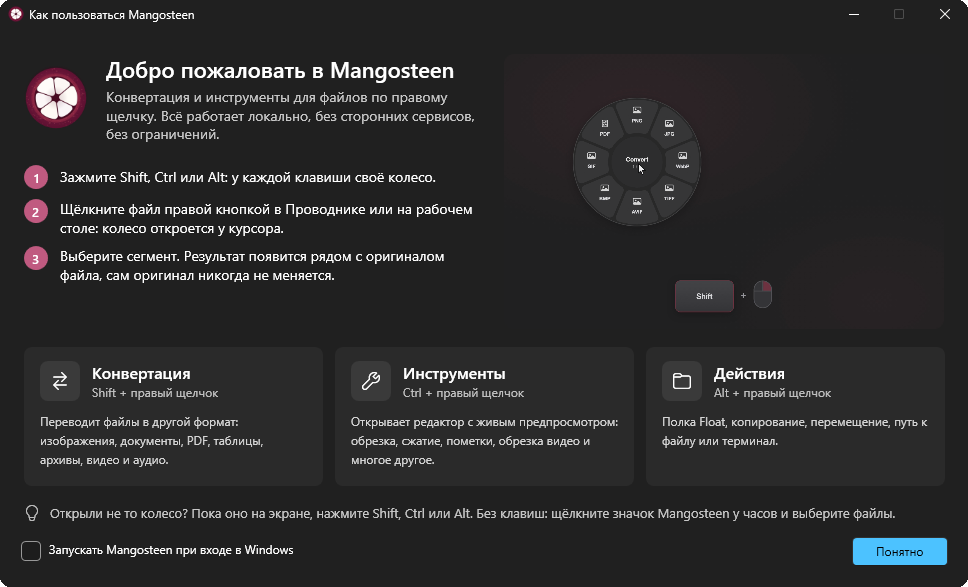
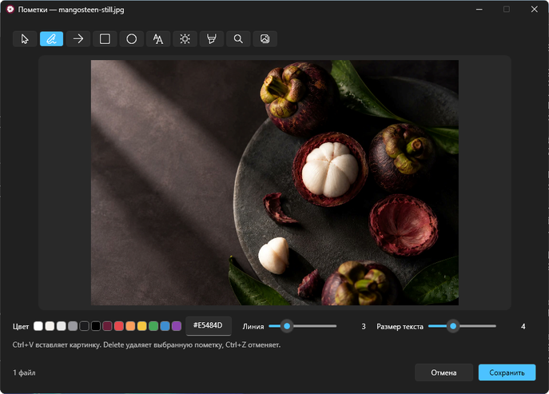
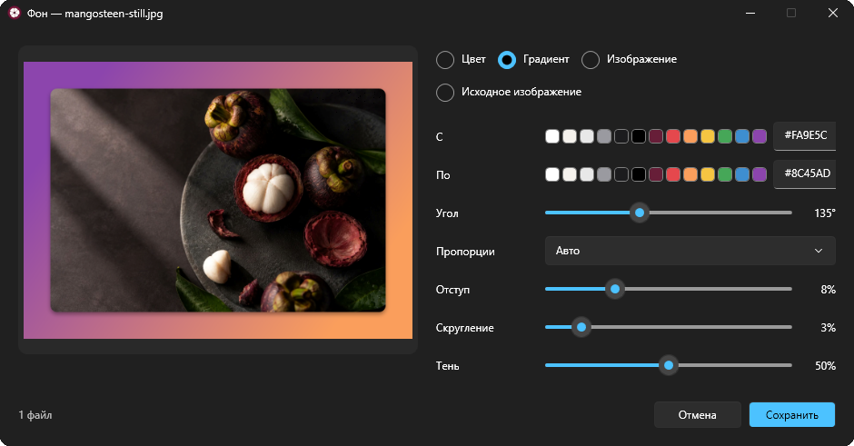
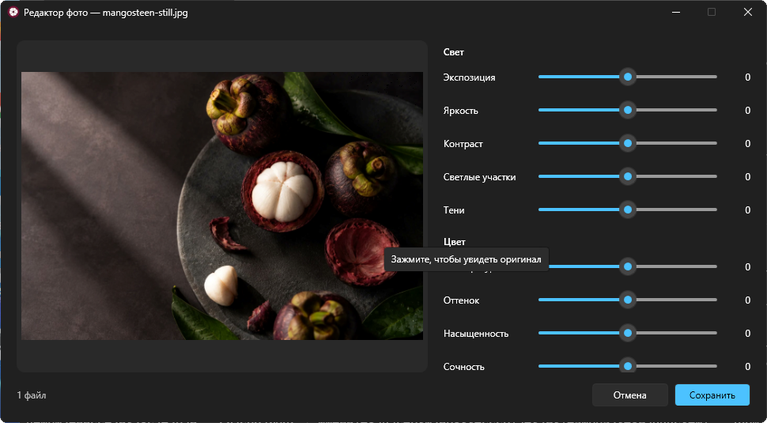
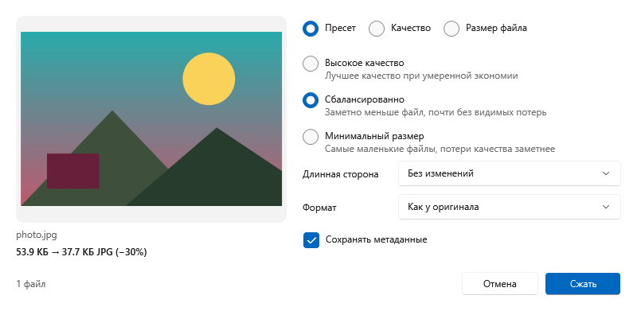
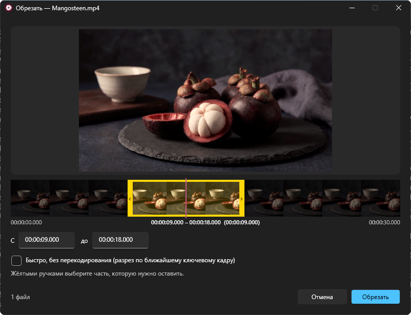
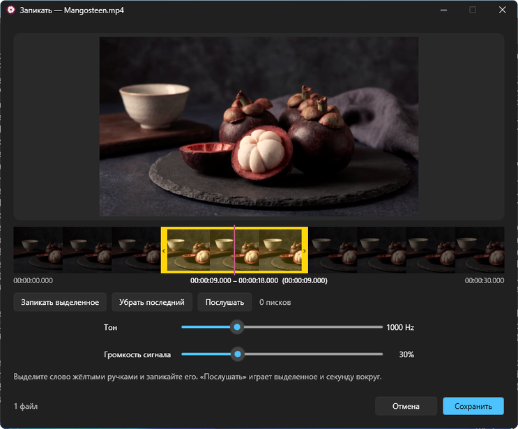

[English](README.md) · *Русский*

<p align="center">
  
</p>

<h1 align="center">Mangosteen для Windows</h1>

<p align="center">
  <b>Конвертер файлов и набор инструментов для Windows без лишних щелчков.</b><br>
  Зажмите Shift, Ctrl или Alt, щёлкните файл правой кнопкой, выберите сегмент — готово.
</p>

<p align="center">
  
  
  
  
  <a href="LICENSE"></a>
</p>

<p align="center">
  <a href="https://github.com/SpaceCadet0/Mangosteen-Windows/releases/latest"><b>Скачать последнюю версию</b></a>
</p>

```
0.0 % CPU в простое · ≈13 МБ частной памяти · 249 МБ загрузка, один exe · без прав администратора, ничего не спрашивает при запуске
```

<sub>Измерено в CI на раннере GitHub windows-latest (Windows Server 2025, 4 ядра): опубликованный exe 60 секунд в простое
после запуска. Память — частный рабочий набор, который показывает Диспетчер задач (рабочий набор целиком — 74 МБ). В
распакованном виде exe занимает 402 МБ, потому что несёт .NET, FFmpeg и модель для удаления фона; FFmpeg запускается
отдельным процессом только на время задачи с видео или аудио, а модель загружается, только пока вы убираете фон.</sub>

---

Windows-версия [Mangosteen](https://github.com/SpaceCadet0/Mangosteen) для macOS. Живёт в области уведомлений и ждёт
правого щелчка. Зажмите клавишу-модификатор, щёлкните правой кнопкой по файлу в Проводнике или на рабочем столе — у
курсора откроется круглое колесо. Выберите сегмент, и результат появится рядом с оригиналом. Без окон, диалогов
сохранения, загрузок в интернет и ограничений. У двух приложений нет общего кода, у каждого свои релизы.

<p align="center">
  <br>
  <sub><a href="docs/media/mangosteen-demo.mp4">Смотреть в MP4</a></sub>
</p>

<p align="center">
  
</p>

| Зажать и правый щелчок | Колесо | Что делает |
|:---:|:---:|---|
| `Shift` | **Конвертация** | Переводит файл в другой формат |
| `Ctrl` | **Инструменты** | Открывает редактор с живым предпросмотром |
| `Alt` | **Действия** | Полка Float, копирование, перемещение, путь, терминал |

Открыли не то колесо? Пока оно на экране, нажмите Shift, Ctrl или Alt. Как и в Проводнике, правый щелчок по
выделенному файлу берёт всё выделение. Правый щелчок без этих клавиш открывает обычное меню, в нём тоже есть подменю
**Mangosteen** (в Windows 11 — в пункте **Показать дополнительные параметры**). Для других приложений в меню значка есть
**Выбрать файлы…**.

## Главное

- **Без лишних щелчков.** В колесе только то, что подходит к выбранным файлам.
- **Оригинал не трогается.** Результат пишется рядом, имена не пересекаются (`photo 2.jpg`).
- **Полностью офлайн.** Всё работает на вашем компьютере, ничего не загружается и не отслеживается.
- **Без ограничений.** Любое количество файлов, любого размера, сколько угодно раз.
- **Один файл.** Самодостаточный `Mangosteen.exe` с FFmpeg внутри: без установщика и без установки .NET.
- **Родное для Windows.** WPF в стиле Windows 11, встроенные в Windows движки PDF, распознавания текста и лиц.
- **Три языка.** Английский, испанский и русский — как в Windows или по выбору в настройках.

## Конвертация

| Тип | Форматы |
|---|---|
| Изображения | PNG, JPG, WebP, TIFF, AVIF, GIF, PDF; ещё читает BMP, ICO и HEIC (с кодеком из Microsoft Store) |
| PDF | в PNG или JPG (несколько страниц — папка со страницами), TXT, Markdown, RTF, DOCX, HTML |
| Документы | DOCX, ODT, RTF, TXT, Markdown, HTML друг в друга и в PDF |
| Видео | MP4, MOV, MKV, WebM, AVI, WMV друг в друга, в GIF и MP3 |
| Аудио | MP3, M4A, WAV, FLAC, OGG, Opus, AIFF, WMA |
| Субтитры | SRT и VTT друг в друга и в TXT |
| Таблицы | CSV, TSV, XLSX друг в друга (книга с несколькими листами — папка таблиц) |
| Архивы | ZIP, TAR, TAR.GZ друг в друга; папки в архивы |

Если контейнер принимает исходные дорожки, видео копируется без перекодирования: мгновенно и без потерь. Текст в старой
кириллической кодировке Windows читается правильно, а CSV открывается в Excel без «кракозябр».

## Инструменты

Каждый инструмент открывает небольшое окно с живым предпросмотром. Если закрыть его, ничего не изменится.

<p align="center">
  
  
</p>

### Изображения и PDF

- **Пометки** — карандаш, стрелки, фигуры, текст, номера шагов, маркер, лупа и вставленные картинки.
- **Фон** — фото на цвете, градиенте, картинке или размытой копии самого себя, с полями, скруглением и тенью.
- **Редактор** — свет, цвет, детали и эффекты; зажмите превью для сравнения, двойной щелчок по слайдеру сбрасывает его.
- **Сжатие** — пресеты, качество, нужный размер файла, уменьшение и формат; работает и для PDF.
- **Обрезка** — свободная рамка, пропорции или точный размер; поворот и отражение; разрезание на части по линиям.
- **Убрать фон** — находит объект моделью, которая работает на вашем компьютере; прозрачный PNG или цвет, по желанию с
  обрезкой по объекту.
- **Текст** — распознаёт текст на фото и в сканах PDF прямо на компьютере и сохраняет его в TXT.
- **Коллаж** — сетка, ряд, колонка или главное фото.
- **Скрыть** — находит лица и текст прямо на компьютере и закрывает их заливкой, размытием или пикселями.
- **Метаданные** — показывает всё, правит основные поля, убирает геопозицию или все метаданные (JPEG не пережимается).
- **Порядок страниц** — порядок, поворот, дублирование и удаление страниц PDF; **Разделить** PDF на части;
  **Объединить** PDF; **PDF из фото**.

<p align="center">
  
  
</p>

### Видео и аудио

<p align="center">
  
  
</p>

- **Обрезать** и **Разделить** на таймлайне с кадрами и приближением; выделение обведено жёлтой рамкой; быстрый режим копирует без перекодирования.
- **Скорость**, **Громкость** (выравнивание по EBU R128, можно послушать) и **Сжатие** с оценкой размера.
- **Запикать** — отметьте слова на таймлайне и послушайте результат до сохранения.
- **Скрыть на видео** — заливка, размытие или пиксели, у каждой области своё время.
- **Кадрировать** видео, **Склеить** ролики, сохранить **Кадры** в PNG, **Каналы** для аудио и **Визуализатор**, который делает из песни MP4.

### Архивы

- **Распаковать** архив рядом с оригиналом; русские имена в ZIP из Проводника распаковываются правильно.

## Действия

- **Float** — плавающая полка с настоящими миниатюрами: держит файлы, пока вы не перетащите их куда-нибудь, в режиме копирования или переноса.
- **Копировать** файлы в буфер обмена, **Переместить** в папку, скопировать **путь**, открыть там **Терминал**.

## Скачать

Скачайте `Mangosteen-win-x64.zip` из [последнего релиза](https://github.com/SpaceCadet0/Mangosteen-Windows/releases/latest)
(249 МБ), распакуйте в любую папку и запустите `Mangosteen.exe`. На диске exe занимает 402 МБ, потому что несёт
.NET, FFmpeg (при первом использовании распаковывается в `%LOCALAPPDATA%\Mangosteen\ffmpeg`) и модель для удаления
фона. В фоне приложение не нагружает процессор и занимает около 13 МБ частной памяти (рабочий набор — 74 МБ). Права администратора не
нужны. Windows 10 и 11, x64.

Сборка не подписана, поэтому SmartScreen может предупредить: нажмите **Подробнее**, затем **Выполнить в любом случае**.
Защитник Windows может в первый раз проверять его дольше: неподписанное приложение, которое распаковывает программы и
следит за мышью, для него необычно.

Mangosteen живёт в области уведомлений рядом с часами. В меню значка — **Недавние результаты** (показать, открыть
или отправить результат в корзину), **Настройки…** (язык, запуск вместе с Windows, меню Проводника), **Приветствие…**,
**Полка Float**, журнал и **Выход**. Сборки каждого коммита лежат в артефактах на
[вкладке Actions](https://github.com/SpaceCadet0/Mangosteen-Windows/actions/workflows/build.yml).

## Если что-то не работает

Mangosteen пишет журнал в `%LOCALAPPDATA%\Mangosteen\mangosteen.log` (**Открыть журнал** в меню значка): каждый
обработанный правый щелчок, каждый результат и каждую ошибку. Приложите его к
[issue](https://github.com/SpaceCadet0/Mangosteen-Windows/issues).

## Сборка

Нужен .NET 10 SDK. Приложение для Windows, но компилируется и на macOS и Linux (`EnableWindowsTargeting`):

```
dotnet build Mangosteen.sln
dotnet test tests/Mangosteen.Core.Tests
dotnet publish src/Mangosteen/Mangosteen.csproj -c Release -r win-x64 -o publish
```

Для видео и аудио FFmpeg должен быть внутри exe: на Windows перед сборкой запустите `build/fetch-ffmpeg.ps1` (так делает
CI). Без него приложение работает, просто не предлагает видео и аудио. Windows-тесты и снимки окон инструментов
запускаются в CI. Строки интерфейса идут через `L("…")`; после добавления текста запустите
`python3 build/build-translations.py` — он не пропустит строку без русского и испанского перевода.

## Лицензия

[MIT](LICENSE). Copyright (c) 2026 Igor Rusakov (SpaceCadet). [Политика конфиденциальности](PRIVACY.md): ничего не собирается и не отправляется. Exe содержит [FFmpeg](https://ffmpeg.org) (GPL v3) как
отдельную программу. Открытые компоненты и их лицензии перечислены в [THIRD-PARTY-NOTICES.md](THIRD-PARTY-NOTICES.md).
